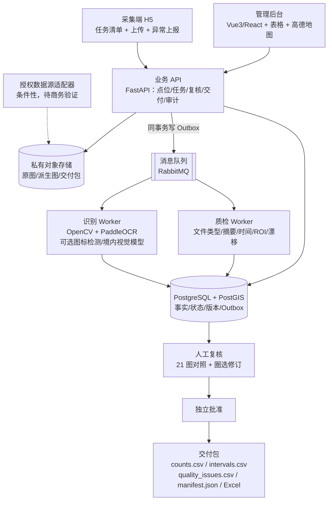

# 电单车数据采集项目：现有方案总结与实现建议

> 文档：`cc_00` ｜ 生成日期：2026-10-30 ｜ 作者：Claude Code ｜ 状态：评审稿
>
> 依据：`docs/` 下 16 份文档（`wb_00`–`wb_07`、`oc_00`–`oc_06`、`visuals/README.md`）、`visuals/` 可视化产物清单、`assets/` 三份原始资料的文件与工作表结构。本文只做归纳与判断，不新增需求事实；凡引用原文处标注文档编号与小节。

---

## 0. 一页结论

1. **两套方案不是同一方案的两个版本，而是两种路线假设。** `wb_` 假设"自动化采集 + AI 数车可以按时按量交付四项指标"；`oc_` 假设"证据可比性优先，真实流量在 10 分钟两端截图下不可得"。这个分歧决定了工期、架构和验收口径。
2. **必须先把"流入/流出"的口径定死，否则后面所有工作都可能白做。** SOP 自带的 4 组对照里 AI 错了 2 组，其中 HB 一组人工为 0:0、系统报 7:8；而产品规格（`oc_01` §4）指出"20 变 20 只能确定净变化为 0"。建议交付主指标为时点车辆数 + 净变化 + 端点变化，真实流量默认标为"不可判定"。
3. **推荐三条轨道并行推进**：① 人工 H5 上传 + 证据链 MVP（可交付、可验收）；② 识别流水线先做"计数"，流量作为研究项；③ 自动化采集（Airtest/真机/模拟定位）只做 PoC，验证通过再谈规模化，不进入首版交付依赖。
4. **工期按 8–10 周规划，不是 4 周。** 4 周能完成的是"单点位纵向切片 + 少量盲测"，不足以支撑一城 20 点交付（`oc_04` §1 与 `wb_06` §2 的差异见 §3.5）。
5. **有 5 件事必须先由业务方拍板**：四个时段的具体时间与每月重复天数 `d`、同一点位是否跨时段复用、真实流量是否为硬验收项、三品牌数据授权范围、点位清单补齐责任方。

---

## 1. 事实基线

### 1.1 已确认（来自原始资料与两份方案的一致部分）

| 项目 | 事实 | 来源 |
| --- | --- | --- |
| 规模 | 12 城 × 4 时段 × 20 点 × 3 品牌 = 960 个点位时段 | PDF 第 1–2 页；`wb_00` §1.2 |
| 采集节奏 | 每点位连续 1 小时，每 10 分钟一轮，共 7 轮（T…T+60） | 同上 |
| 空间 | 停车点为中心 100 m × 100 m，GCJ-02 | 同上 |
| 单期截图 | 960 × 3 × 7 = 20,160 张 | 同上 |
| 周期 | 长期，每月一期 | 同上 |
| 点位完成度 | 仅 7/960（南宁 3 + 洛阳补点 4），<1% | `oc_00` §3；`wb_00` §2.2 |
| 现场验证 | 至少 1 次（南宁振兴路，周中晚 18:00–19:00） | `wb_00` §2.1 |
| 关键实测 | 计数基本可靠；流量判断 4 组抽样错 2 组 | `wb_00` §2.2；`wb_03` §1.2 |

### 1.2 尚未确认（会直接改变方案）

- 每期每点位重复几次（`d`）；四个时段的准确起止时间；同一批 20 点是否四个时段复用。
- "真实流量"是否为硬验收项；若成立，需要连续事件证据或现场连续视频（`oc_01` §4）。
- 三品牌的数据授权、字段、刷新频率、是否提供稳定匿名车辆 ID。
- 真实账号数量与可用性（`wb_00` §2.3 仍标"收集中"）。
- 预算、保存期限、验收误差、监控中心定义。

---

## 2. 两套方案对照

| 维度 | `wb_`（WorkBuddy） | `oc_`（Codex） | 本评审倾向 |
| --- | --- | --- | --- |
| 路线假设 | 自动化优先：Airtest + ADB 模拟定位 + 真机 → 无人值守采集 | 证据优先：首版人工 H5 上传，自动化列为条件性二期 | `oc_` |
| 采集手段 | Airtest/Poco 操控三家 App、ADB mockLocation、账号池、反检测 | H5 手动上传；Android MediaProjection 仅作采集助手；授权接口为长期首选 | `oc_` |
| 指标口径 | 直接交付 车辆数/流入/流出/疑似调度入 四列 | 六类指标分列，带 `status/method/evidence_ids`，净变化与真实流量严格区分 | `oc_` |
| 识别方案 | YOLOv8s + SIFT/RANSAC 配准 + 匈牙利匹配 + 多帧确认 + DBSCAN 调度识别 | OpenCV/PaddleOCR 基线 + 可选检测模型 + 境内视觉模型辅助 + 人工复核 | 融合：`wb_` 管道作为识别轨道 |
| 后端 | FastAPI + Celery + Redis + PostgreSQL 15 + PostGIS + MinIO | FastAPI + Celery + RabbitMQ + PostgreSQL 16 + PostGIS + OSS；数据库 Outbox | `oc_` |
| 前端 | React 18 + Ant Design 5 + Konva + 高德 JS API + Vite | Vue 3 + TS + Element Plus + ECharts + 高德 JS API | 按团队栈；契约以 `oc_` 为准 |
| 调度可靠性 | Celery `eta` 排 7 轮；重试 3 次 | 数据库槽位 + 租约认领 + Outbox + 幂等键 + `deadline_at` 漏采状态 | `oc_` |
| 空间数据 | `GEOMETRY(POLYGON, 4326)` 存 GCJ-02，声称"无需坐标转换" | 几何列 SRID 0 + 另存 `coord_sys`，禁止伪标 4326 | `oc_` |
| 质量体系 | 三层校验 + 5 条规则 + 全检/10% 抽检 | 11 个质量码 + 状态机 + 角色分离 + 不可变交付版本 | 融合（`oc_` 为主） |
| 工期 | 4 周完成南宁 20 点试点 | 8–10 周完成 MVP + 一城试点 | `oc_` |
| 合规立场 | 明确不把接口逆向作交付依据，但保留反检测章节与 P2 逆向探索 | 明确不把模拟定位/逆向/风控绕过/账号池作为生产默认依赖 | `oc_` |
| 可视化 | Mermaid 内嵌（8 张） | archify 生成的 4 张交互 HTML + 双主题截图 + 校验回执 | 均保留 |

### 2.1 两份文档的分工建议（避免继续漂移）

- **`oc_01`–`oc_04` 作为契约层**：指标定义、数据实体、API、验收门槛、实施关卡。后续代码与报告以此为准。
- **`wb_02`/`wb_03`/`wb_06` 作为工程实现层**：三家 App 的操作细节、模板图清单、YOLO 训练与配准参数、Docker Compose 骨架。
- 需求参数只在 `AGENTS.md` 指向的原始资料里定义一次，两套文档都改为引用，不再各自复述（当前 `wb_00` §1.2 与 `oc_01` 已有重复描述，后续必然不一致）。

---

## 3. 六处关键分歧与裁决

### 3.1 指标口径（决定性分歧）

`wb_` 把 7 个时点的截图两两比对，直接输出"流入/流出/疑似调度入"（`wb_03` §7）。`oc_` 指出：10 分钟间隔的两端快照会漏掉"进入后又离开"的车辆，只能得到净变化与端点变化，不能声称完整真实流量（`oc_01` §4）。

SOP 的实测支持 `oc_` 的立场：人工 0:0 而系统给出 7:8，说明当时算法既不是净变化也不是端点匹配，而是不稳定推断。

**裁决：**

| 指标 | MVP 定位 | 展示方式 |
| --- | --- | --- |
| `platform_visible_count` | 主交付指标 | 值 + 证据 ID |
| `physical_count` | 现场口径，单独列 | 有则填，无则 `null` |
| `net_change` | 交付 | 期末 − 期初 |
| `endpoint_in/out` | 交付但标方法 | `method=endpoint_match`，低配准置信度时降级 |
| `gross_in/out` | 默认 `unobservable` | 仅在取得连续事件/视频时填值 |
| `suspected_dispatch_in` | MVP 只记人工确认事件 | 计入总流入时不得重复计数 |

每个可空指标必须带 `status ∈ {proposed, approved, unobservable, missing, rejected}`、`method`、`reason_code`、`revision`；`value=0` 只能表示有证据的零，缺数据写 `null`（`oc_03` §2）。

### 3.2 采集路线

`wb_` 的自动化链条有 5 个未验证前提：模拟定位能被目标 App 接受、单机 30 秒内切换三品牌、比例尺可自动对齐、账号池可持续登录、反检测策略有效。`oc_` 逐条给出了系统边界：MediaProjection 需用户逐次授权、单 App 窗口共享不跟随切换、云视觉须核实境内推理范围（`oc_05` §2.5、§2.3）。

**裁决：** 首版交付用人工 H5 上传；自动化采集作为独立 PoC，用实测数据决定是否进入二期。若单机切换达不到 30 秒极差，只允许"一品牌一台设备"作为备选，且必须实测定位/账号/网络，不能只按设备数推断可用（`oc_02` §3）。

### 3.3 技术栈与空间数据

两套栈大部分等价（FastAPI、PostGIS、对象存储、队列、Celery、高德）。真正的技术风险只有一处：**`wb_04` §2.1 用 `GEOMETRY(POLYGON, 4326)` 存 GCJ-02 坐标**。PostGIS 的 `ST_SetSRID` 只改标签不做变换（`oc_05` §2.2），这样存会在导出、第三方对接、空间函数距离计算时产生系统性偏差，并且对外表现为"已按 WGS84 交付"。

**裁决：** 几何列用 SRID 0 + `coord_sys='GCJ-02'` 显式标注；100 m 方形用经验证的局部米制近似构造并记录算法版本与误差；跨坐标系数据未经验证转换不得混算。其余：PoC 用 MinIO（S3 兼容），生产切 OSS；前端按团队栈选择，`oc_` 的 Vue 栈与现有审核表格场景更贴合，React 方案可等价替换，不影响后端契约；Konva 的截图圈选能力（`wb_05` §2.2）无论选哪套前端都保留。

### 3.4 调度与可靠性

`wb_04` §1.3 用 Celery `eta` 为 7 轮预排任务。broker 重启、worker 崩溃或容器重建都会丢计划，而且计划丢失后无法区分"没采"与"没排"，直接破坏 99% 完整率验收（`oc_01` §5）。

**裁决：** 采用 `oc_02` §5 的模型：数据库为唯一事实源，每个计划槽位持久化；调度器用租约+行锁认领；Outbox 与业务提交同事务；Worker 按 `evidence_id+pipeline_version` 幂等；过期槽位标 `MISSING_CAPTURE`，迟到图片另存为迟到证据而不是覆盖。

另一个细节：`wb_04` §1.3 建议"同城点位错开 5 分钟开始以避设备冲突"。这会破坏同一时段的可比性，也与"三品牌同轮极差 ≤30 秒"的目标冲突。错峰只能发生在"不同城市/不同时段"之间，不能发生在同一批 20 点内部。

### 3.5 工期与范围

`wb_06` 计划 4 周内完成：Docker/DB/API/前端骨架 + 三家 App 操控脚本 + 200 张标注 + YOLO 训练 + 配准与匹配算法 + 20 点实采 + 人工核对 + 验收。其中"三家 App 操控脚本"单项在 `wb_06` §4.2 就写明"这是最耗时的开发工作"，且模板图、风控、App 版本变化都不可控。

**裁决：** 采用 `oc_04` 的 8–10 周分阶段路线（见 §6）。如果必须在 4 周内交出可见成果，定义为"纵向切片"：1 个点位 × 3 品牌 × 7 轮 = 21 张，人工上传 → 质检 → 复核 → Excel 全链路，外加 5–10 个 Session 的计数盲测。不承诺多设备并发与全城交付。

### 3.6 合规边界

`wb_02` §9 的反自动化措施包含固定操作节奏打散、设备指纹修改、代理池 IP 轮换、单账号限频；`wb_07` 包含 mitmproxy 抓包、JADX 反编译、Frida 钩签名。`wb_07` 自己也承认合规风险并限定"不对外交付、最多投 2 周"。

**裁决：** 这些能力不进入生产依赖，也不作为交付说明的一部分。首版以"采集人员按 SOP 正常使用官方 App"为唯一采集方式；长期方向是争取品牌方或有权供应商的授权数据（`oc_02` §3.A）。若客户要求"规模化自动化"，应先由业务方完成平台授权评估，而不是由工程侧靠技术手段绕过平台限制。

---

## 4. 建议的整体架构

要点：业务 API 与识别 Worker 分开发布；对象存储直传，不经 API 中转大文件；识别失败可重算，历史采集不可重放。

---

## 5. MVP 最小数据模型

在 `oc_03` §1 的基础上裁剪，保留可追溯所必需的实体，暂不建授权数据源相关表：

| 实体 | 作用 | MVP 是否必需 |
| --- | --- | --- |
| `project` / `site` / `site_version` | 组织隔离与点位版本（历史不可变） | 必需 |
| `monitoring_region` | 100×100 监控区域，与停车围栏分开 | 必需 |
| `campaign` | 日期、时段、计划点位；冻结验收分母 | 必需 |
| `session` / `brand_run` | 单点位单时段的一次采集 × 品牌 | 必需 |
| `capture_slot` (0..6) / `capture_attempt` | 计划槽位与实际尝试分离 | 必需 |
| `evidence` | 原件不可覆盖，SHA-256 + 对象版本 | 必需 |
| `count_result` / `interval_result` | 指标值 + status/method/证据 | 必需 |
| `quality_issue` | 质量码 + 严重度 + 处置 | 必需 |
| `review` / `audit_event` | 修订与审计，追加写 | 必需 |
| `delivery` | 固定结果 revision 的交付包 | 必需 |
| `analysis_run` | 模型/代码/提示词/ROI 版本 | 建议 |
| `source_contract` | 授权来源与能力声明 | 二期 |

状态机：`draft → scheduled → collecting → processing → review_required → approved → published`；失败、缺失、取消是独立状态或异常原因，不得流入 `approved`（`oc_03` §2）。

---

## 6. 分阶段实现路线

| 阶段 | 周 | 交付 | 放行条件 |
| --- | --- | --- | --- |
| **P0 口径与来源** | 1 | 冻结指标草案、区域定义、三品牌来源与授权清单、验收门槛 | 每条指标写明证据要求；不可得的能力明确标 `unobservable` |
| **P1 纵向切片 + PoC** | 2–3 | 单点位 21 图全链路（人工上传）；识别与同步实验 | 证据能绑定到准确槽位；单机三品牌切换、计数误差有实测数据 |
| **P2 MVP** | 4–6 | 点位导入预检、排班冻结、质检、复核工具、导出、审计 | 单点流程端到端通过；无数据不写零；每个值可追到证据 |
| **P3 一城试点** | 7–8 | 一城 20 点（优先用已有点位的南宁/洛阳） | 按 P0 冻结门槛出具实测报告；未达标项降级为能力缺口 |
| **P4 多城准备** | 9–10 | 容量测算、国内部署、备份恢复演练、供应商培训 | 资源覆盖峰值；权限、备份、交付验收完成 |

与 `wb_` 的 4 周计划对照：`wb_` 的 Week 1–3 对应本表 P2 的一部分，`wb_` 的 Week 4 对应 P3 的单城市子集。差异不在人力，而在"自动化采集"和"流量准确率 80%"这两个未验证前提是否需要先做实验。

---

## 7. PoC 实验清单（用 2–3 周换取确定性）

| 实验 | 怎么做 | 决策依据 |
| --- | --- | --- |
| 时点计数 | 人工 / OpenCV 基线 / 专用检测 / 境内视觉模型辅助 四路对比 | ≤1 辆命中率、自动覆盖率、单张耗时、分品牌差异 |
| 同步能力 | 单机切换三品牌 vs 一品牌一机并行，实测 | 计划偏差与同轮极差能否 ≤30 秒 |
| 流量上限 | 两端快照 vs 现场连续视频真值 | 漏检比例，直接决定 `gross_in/out` 能否交付 |
| 空间一致性 | 围栏 / 100 m 区域 / 现场圈选三者对比 | 边缘车辆、比例尺、配准误差 |
| 设备稳定性 | 不同机型、锁屏、来电、弱网、权限撤回 | 黑屏率、漏采率、人工干预比例 |
| 调度事件 | 现场可验证补车 vs 数量突增 | 可判定样本、误报来源 |

低成本起步建议：先用现有 7 个点位 + SOP 的 21 张截图跑"检测 + 配准 + 端点匹配"，不需要等 960 个点位补齐。样本量不足以宣称全项目准确率（`oc_04` §2.1 要求不少于 30 个 Session 才出首轮分层评估）。

---

## 8. 容量、人员与成本

以 `d=1`（每点位每期采集 1 次）测算，来自 `oc_04` §5–6，`d` 未在 PDF 中明确：

| 项目 | 一整期 |
| --- | --- |
| Session | 960 |
| 品牌小时 | 2,880 |
| 图片 | 20,160 |
| 区间记录 | 17,280 |

- **峰值**：若 12 城 4 时段全部同时采集，为 240 个 Session、720 条品牌通道、每轮 720 张。若采"一品牌一真机"，示例峰值需 720 台设备（不含备用）——这是该采集方式的容量结果，不是建议采购数量。这也从数量级上说明为什么不能默认走真机自动化。
- **上传**：720 张 / 30 秒 ≈ 24 张/秒；按 2 MB/张约 48 MB/s，必须直传对象存储。
- **识别**：单 Worker 实测 1 张/秒时，120 秒处理 SLA 约需 6 个并行通道。
- **存储**：2 MB/张 → 40.3 GB/期；六个月约 242 GB 原图，预算按 2–3 倍预留。注意 `wb_04` §2.2 按 500 KB/张估 10 GB/期，与 `oc_` 差 4 倍，采购前须用真实截图实测。
- **人员**：产品/交付 1、后端 1、前端 1、CV 1、QA/运维合计约 1；现场协调与标注员另计。若只有 1–2 名开发者，先砍掉自动识别与移动端，只做人工上传与复核交付（`oc_04` §4）。
- **成本占位**（人民币/月，非报价）：PoC 600–4,100；生产试运行 4,300–16,000。不含品牌数据授权、地图商业许可、GPU 常驻、人力与设备采购。模型费用按"调用张数 × 实测计费量"计算，先用 100 张样本看真实账单。

---

## 9. 风险与停止条件

| 风险 | 触发信号 | 应对 / 停止条件 |
| --- | --- | --- |
| 真实流量为硬验收但无可得连续证据 | P1 实验显示漏检无法收敛 | 在 P1 报告阻断，不以净变化冒充流量（`oc_04` §1） |
| 单机三品牌同步不可达 | 实测同轮极差 > 30 秒 | 改一品牌一机并行或调整时间容差，须甲方书面确认 |
| 点位清单补齐滞后 | 单城有效点 < 20 | 试点范围收窄，交付包标注计划值/有效值/缺失值 |
| 授权缺失 | 无品牌授权或采集不被允许 | 只保留人工+授权数据路径，不做技术绕过 |
| 计数盲测不达标 | ≤1 辆命中率 < 95% | 提高人工复核比例，不宣称"自动通过" |
| 设备/账号不稳定 | 漏采率 > 1% | 增加备用设备与补采窗口；不把漏采计入分母 |

---

## 10. 现有文档与资产的问题清单

| # | 严重度 | 问题 | 位置 |
| --- | --- | --- | --- |
| 1 | 已修复 | 原始资料路径已统一为实际存在的 `assets/`，相关来源链接与导入示例已同步 | `AGENTS.md`、`CLAUDE.md`、`oc_00` §3、`wb_00` §1.1 |
| 2 | 高 | 指标口径冲突：`wb_` 交付真实流入流出，`oc_` 证明不可得；SOP 自身 2/4 组失败 | `wb_03` §7 vs `oc_01` §4 |
| 3 | 高 | `wb_03` §5.2 建议"截图视野≈整个围栏，无需精确映射"，与 100×100 米边界要求冲突，围栏筛选实际被跳过 | `wb_03` §5.2 |
| 4 | 高 | GCJ-02 存入 `GEOMETRY(4326)`，属错误坐标标签 | `wb_04` §2.1 |
| 5 | 中 | Celery `eta` 排 7 轮，重启即丢计划，无漏采状态 | `wb_04` §1.3 |
| 6 | 中 | "同城点位错开 5 分钟"破坏同时段可比性 | `wb_04` §1.3 |
| 7 | 中 | 匹配距离阈值文本 50 px、推导 ~170 px、结论仍取 50 px，未标定 | `wb_03` §6.4 |
| 8 | 中 | 准确率提升数字（85→95、50→80）无来源 | `wb_03` §10.5、§12.3 |
| 9 | 中 | 单张体积口径 500 KB vs 2 MB，导致存储与带宽预算差 4 倍 | `wb_04` §2.2 vs `oc_04` §6 |
| 10 | 中 | 反自动化与被检测规避内容（指纹修改、代理池、Frida）不宜进入交付或生产 | `wb_02` §9、`wb_07` §3 |
| 11 | 低 | README 导航链接写成 `docs/wb_00_...`，从 `docs/` 解析会变成 `docs/docs/` | `wb_README.md` 末尾 |
| 12 | 低 | `.gitignore` 忽略 `AGENTS.md`、`CLAUDE.md`、`visuals/screenshots/`，共享规范与已交付截图不入库 | `.gitignore` 2–7、53–57 行 |
| 13 | 低 | 两套文档重复描述需求与架构，后续必然漂移 | `wb_00` §1.2 vs `oc_01` §1 |
| 14 | 低 | `visuals/README.md` 声明 `wb_` 前缀对应可视化文件，实际 `visuals/` 只有 `oc_` 产物 | `visuals/README.md` §文件命名规则 |

另：`wb_README.md` 的"快速开始"给出了 `docker-compose`、`scripts/load_points.py` 等命令，但仓库中没有任何代码。该文件已注明是规划示例，仍建议把示例代码移到 `docs/examples/` 或在命令块前加显式警示，避免被当成可执行步骤。

---

## 11. 未来两周行动清单

**决策类（业务方）**

- [ ] 冻结四个时段的准确时间、每月采集日期与重复次数 `d`。
- [ ] 书面确认"真实流入/流出"是否为硬验收项；若否，接受净变化+端点变化口径。
- [ ] 明确同一点位是否跨时段复用，以及 100×100 区域的定义方式。
- [ ] 指定点位补齐责任人与时间表（当前 7/960）。
- [ ] 启动三品牌授权沟通，使用 `oc_05` §4 的供应商询问模板。

**工程类（本周）**

- [ ] 用 7 个现有点位 + SOP 的 21 张图，跑通"检测 → 配准 → 端点匹配"，产出第一份误差分布。
- [ ] 实测一台真机在三个 App 间切换并完成截图的耗时，记录同轮极差。
- [ ] 落一个最小骨架：`POST /capture-attempts` + 直传 + `evidence` 表 + 一条质检规则。
- [ ] 确定交付三件套字段（`counts.csv`、`intervals.csv`、`quality_issues.csv`），先与客户对齐表头再写代码。
- [x] 原始资料路径统一为 `assets/`，已同步 agent 指南、来源链接及容器导入示例。
- [ ] 指定唯一事实源：`oc_01`–`oc_04` 为契约，`wb_02`/`wb_03`/`wb_06` 为实现参考。

**工程类（两周内）**

- [ ] 完成 10 个 Session 的三品牌人工真值，作为第一版盲测集。
- [ ] 产出识别方案对比（OpenCV 基线 / 检测模型 / 视觉模型辅助）的分品牌误差与单张耗时。
- [ ] 落人工复核界面原型（21 图对照 + 圈选修订 + 版本锁）。
- [ ] 输出 P1 结论：可交付指标清单 + 明确的能力缺口。

---

## 附录 A 文档索引与阅读映射

| 文档 | 内容 | 在新方案中的角色 |
| --- | --- | --- |
| `oc_00`–`oc_06` | 产品规格、架构、数据/API、实施、国内服务、可视化导览 | **契约层**，优先阅读 |
| `wb_00` | 项目背景、状态评估、风险矩阵 | 背景与现状 |
| `wb_01` | 模块划分、技术选型、目录结构、DB 草图 | 实现参考（需按 §3.3 修正） |
| `wb_02` | Airtest 操控、设备与账号池、SOP 技术化对照 | 自动化 PoC 参考 |
| `wb_03` | YOLOv8、配准、匹配、调度识别、训练 | **识别轨道主文档** |
| `wb_04` | 调度、Schema、围栏、API | 参考，可靠性部分以 `oc_02` 为准 |
| `wb_05` | 三层校验、核对工具、报告、验收 | 与 `oc_01` 合并使用 |
| `wb_06` | 4 周试点与 Docker Compose | 压缩为 P1 纵向切片 |
| `wb_07` | API 逆向探索 | 不纳入交付路线 |
| `visuals/html/oc_*.html` | 4 张交互图（工作流、架构、上传、处理） | 评审与对外沟通材料 |

---

*本文为 Claude Code 基于仓库现有文档生成，未修改任何原始资料或他人文档。*
