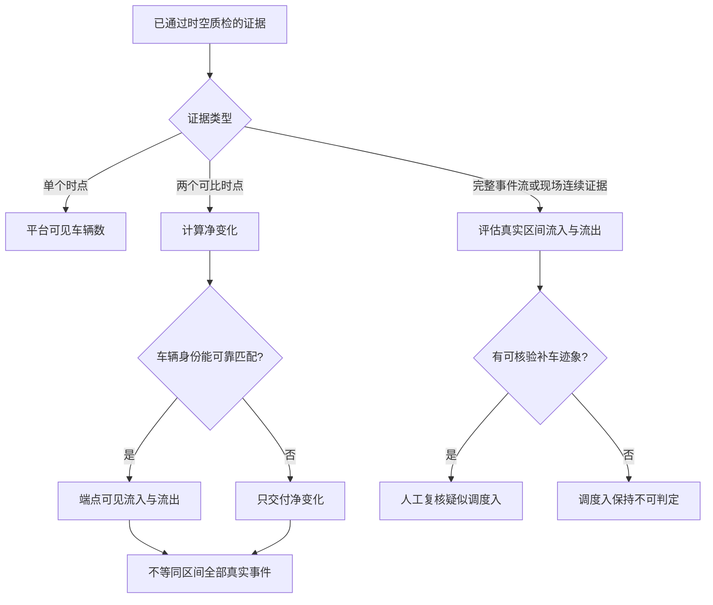

# 电单车平台：可视化导览

日期：2026-10-30。图示表达的是建议设计，尚未实现上线。推荐先读业务流程，再看架构与两张时序图。

## 1. 四张交互图

| 图 | 入口 | 主要内容 |
| --- | --- | --- |
| 工作流程 | [采集到交付](../visuals/html/oc_workflow.html) | 点位确认、排班、21 图采集、质检、异常、分析、人工核验与交付 |
| 系统架构 | [组件关系](../visuals/html/oc_architecture.html) | 管理端、采集端、业务 API、数据库、OSS、消息队列与识别 Worker |
| 上传时序 | [证据上传](../visuals/html/oc_sequence.html) | 申请 attempt、受限上传凭证、OSS 直传、校验、证据与 Outbox 事务提交 |
| 处理时序 | [异步处理与审核](../visuals/html/oc_processing.html) | Outbox 派发、队列、Worker 幂等处理、人工修订、独立批准与版本固定 |

HTML 文件包含图形与查看器，可本地打开，支持缩放、聚焦、深浅主题和导出。阅读图形不依赖在线地图、云账号或品牌接口。图中的“视觉模型辅助”是可选组件，必须核实境内推理范围。

## 2. 流程图怎样读

主路径从点位与统计口径确认开始。排班冻结后，每个点位时段产生三品牌各七个槽位。采集端保留原图，平台完成摘要、时间、区域与遮挡检查；合格证据进入辅助分析，再由人工核验与独立审核人批准。

质检不合格进入异常登记。可重新上传原时刻已有的有效证据，或由复核员判断可用性；已经错过的历史采集时刻不能事后补拍。无法恢复的缺失，必须出现在交付包中。异常节点是异常登记路径终点，不表示异常已被批准或自动消失。

## 3. 架构图怎样读

- 管理与复核端通过业务 API 操作任务，API 负责鉴权、版本和审计。
- 数据库保存业务事实、结果及 Outbox；图中的“可靠任务派发”把数据库 Outbox 与派发器/消息队列概括为一个逻辑模块，不代表单独第二份事实库。
- 采集端使用 API 颁发的临时授权直传 OSS；原图不经 API 大文件中转。
- Worker 从队列获取任务、读取 OSS，分析结果通过受控业务逻辑写回数据库；为降低连线密度，该回写在架构图卡片与处理时序中说明。
- 授权结构化数据源属于另一种采集入口；图中概括展示，不意味着已取得三品牌接口。

## 4. 时序图怎样读

上传与处理被拆成两张，避免一张过长。API 在证据与 Outbox 成功提交后返回“已接收”，此时不代表分析、复核或交付完成。第二张图的“处理链路”合并展示派发器、RabbitMQ 与 Worker，不代表数据库直接推送业务任务。

队列按照至少一次消费设计，Worker 用证据 ID 与流水线版本幂等写入。模型失败可以重算，原时刻漏采不能重算恢复。人工修订使用版本锁，最终批准固定结果版本；导出在批准后异步执行。

## 5. 指标判定图：证据能支持什么

下面的 Mermaid 图便于嵌入后续规格和评审材料。连续现场证据还需通过覆盖、可辨识度和完整性验证。



## 6. 维护与验证

图形源文件为 `visuals/configs/oc_*.json`，交付回执为 `visuals/configs/oc_*_delivery.json`。浏览器检查回执位于 `visuals/configs/`，截图位于 `visuals/screenshots/`，HTML 与截图预览页位于 `visuals/html/`。不要手工修改生成的 HTML；调整 JSON 后重新验证与交付。

使用本机 archify 技能重新生成，例如：

```bash
node /Users/william.jiang/.agents/skills/archify/bin/archify.mjs validate workflow visuals/configs/oc_workflow.json --quality showcase --json
node /Users/william.jiang/.agents/skills/archify/bin/archify.mjs deliver workflow visuals/configs/oc_workflow.json visuals/html/oc_workflow.html --quality showcase --json
```

设计依据：[产品规格](oc_01_product_spec.md)、[架构规格](oc_02_architecture_spec.md)、[数据与接口规格](oc_03_data_api_spec.md)。完整性、浏览器检查、视觉复核和文件摘要记录见 [验证记录](../visuals/configs/oc_validation_report.md)。

目录迁移说明：原始交付与浏览器回执保留生成时路径，其 SHA-256 仍对应未改动的交互图。当前文件位置和迁移后校验见 [迁移清单](../visuals/configs/oc_relocation_manifest.json)。重新运行 `visual-check` 会在 HTML 旁生成新的检查文件，归档时须同步调整截图预览链接。
