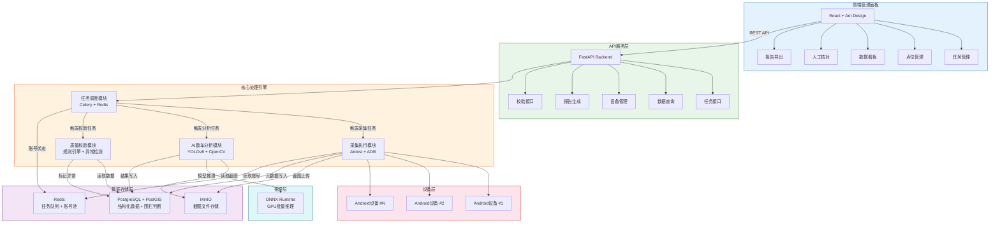
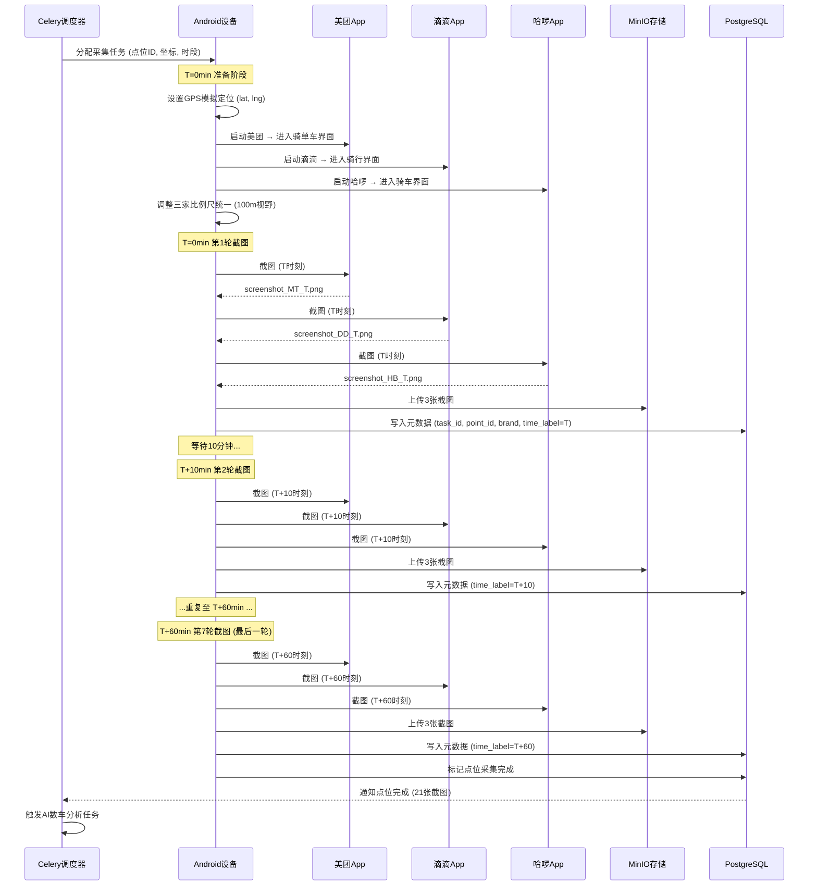
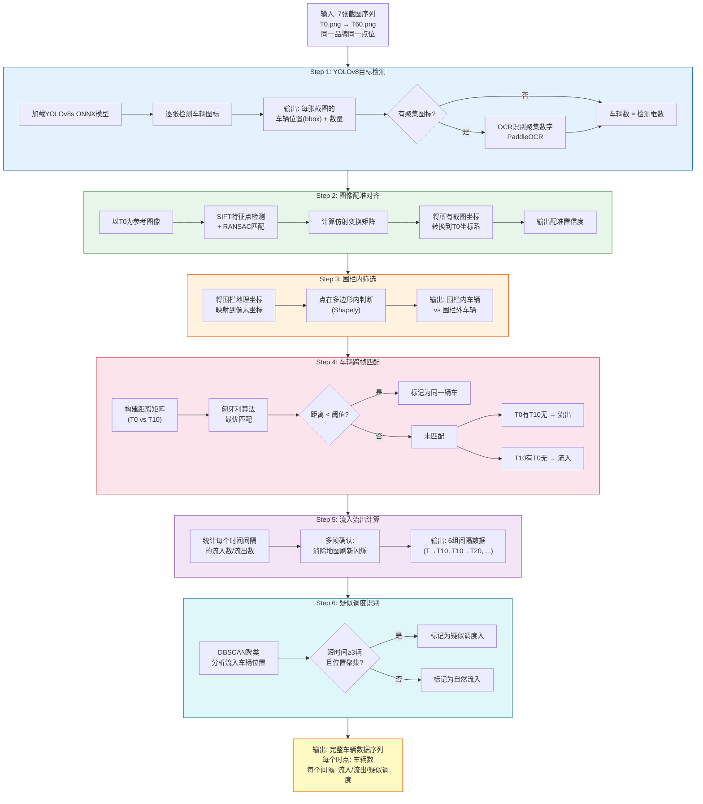
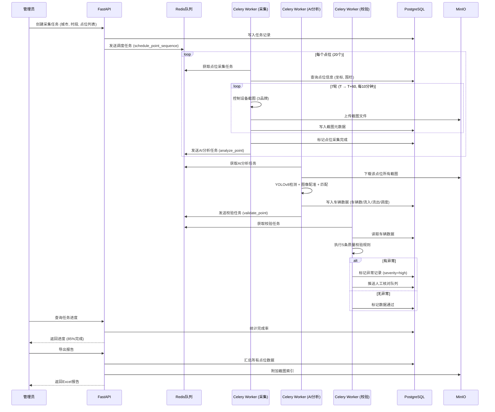
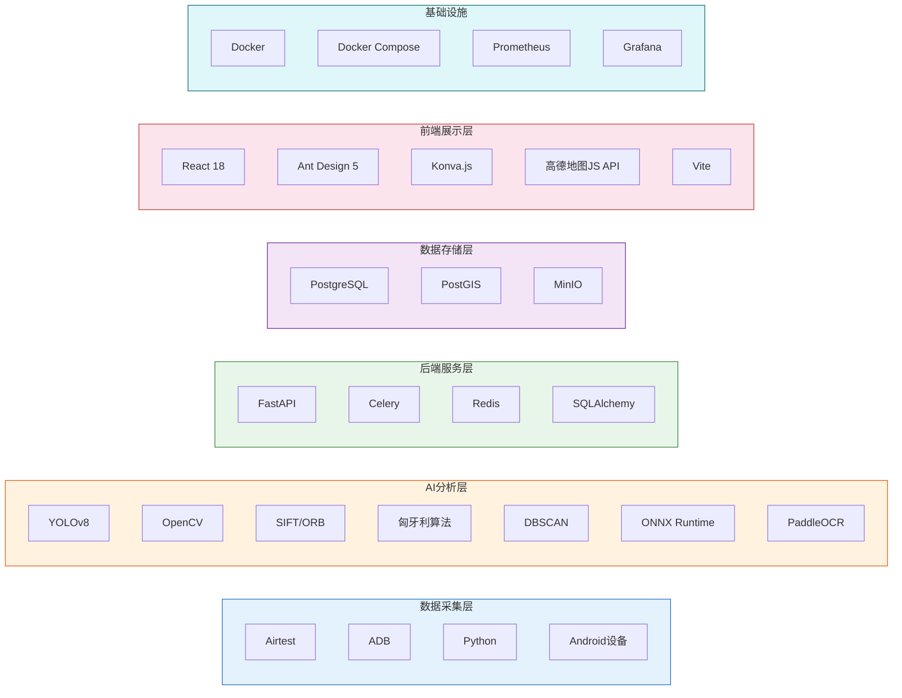
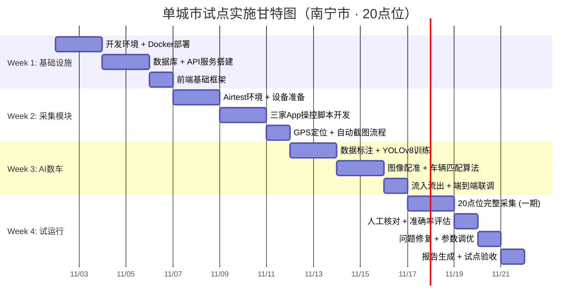
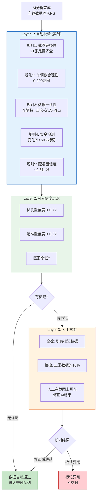
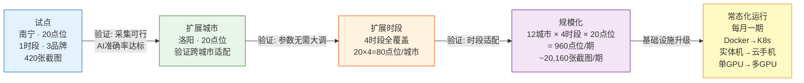

# 电单车多平台车辆分布数据采集系统

> 共享电单车竞品数据监测平台 — 自动化采集美团(MT)、滴滴(DD)、哈啰(HB)三家平台的车辆实时分布数据

---

## 项目简介

本项目为乙方（供应商）承接的共享电单车竞品数据监测系统。通过自动化操控三家电单车平台App截图，结合YOLOv8目标检测和图像比对算法，定期输出各城市各点位的车辆分布、流入流出和疑似调度数据。

### 核心指标

| 指标 | 值 |
|------|-----|
| 覆盖城市 | 12个 |
| 时段数 | 4个（周中/周末 × 早/晚高峰） |
| 每城市点位数 | 20个 |
| 总点位数 | 960个 |
| 覆盖平台 | 3家（MT / DD / HB） |
| 单期截图数 | ~20,160张 |
| 采集频率 | 每10分钟一轮，每点位7轮（1小时） |
| 围栏范围 | 100m × 100m 正方形 |
| 坐标系 | GCJ-02 |
| 项目周期 | 长期，每月一期 |

---

## 系统架构图



---

## 端到端数据流 Workflow

```mermaid
flowchart LR
    T1["管理员创建<br/>采集任务"] --> T2["Celery调度引擎<br/>按时间触发"]
    T2 --> T3["采集模块控制<br/>Android设备"]
    T3 --> T4["模拟GPS定位<br/>到目标点位"]
    T4 --> T5["打开三家App<br/>找车界面"]
    T5 --> T6["调整比例尺<br/>三家对齐"]
    T6 --> T7["截图保存<br/>3品牌×7轮=21张"]

    T7 --> T8["截图存入MinIO<br/>元数据写入PG"]
    T8 --> T9{"该点位<br/>7轮完成?"}
    T9 -->|否| T3
    T9 -->|是| T10["触发AI数车<br/>批量分析"]

    T10 --> T11["YOLOv8检测<br/>车辆图标"]
    T11 --> T12["SIFT图像配准<br/>对齐截图"]
    T12 --> T13["围栏内筛选<br/>100m×100m"]
    T13 --> T14["匈牙利算法<br/>车辆匹配"]
    T14 --> T15["计算流入流出<br/>+疑似调度"]
    T15 --> T16["结果写入PG"]

    T16 --> T17["自动质量校验<br/>5条规则检查"]
    T17 --> T18{"有异常<br/>数据?"}
    T18 -->|是| T19["推送人工核对<br/>队列"]
    T18 -->|否| T20["数据通过"]
    T19 --> T21["人工在截图上<br/>圈车修正"]
    T21 --> T20

    T20 --> T22["生成Excel<br/>交付报告"]
    T22 --> T23["截图索引 + <br/>质量报告"]
    T23 --> T24["交付甲方"]

    style T1 fill:#e3f2fd,stroke:#1565c0
    style T10 fill:#fff3e0,stroke:#e65100
    style T17 fill:#e8f5e9,stroke:#2e7d32
    style T24 fill:#f3e5f5,stroke:#6a1b9a
```



---

## 单点位采集时序图



---

## AI数车分析管道



---

## 任务调度时序图



---

## 技术栈全景



---

## 试点实施计划（4周）



---

## 数据校验流程



---

## 从试点到规模化路径



---

## 文档导航

| 文档 | 内容 | 优先级 |
|------|------|--------|
| [wb_00_project_overview.md](docs/wb_00_project_overview.md) | 项目背景、需求、状态评估、技术路线总览 | - |
| [wb_01_system_architecture.md](docs/wb_01_system_architecture.md) | 系统架构、模块划分、技术选型、部署方案、DB Schema | P0 |
| [wb_02_data_collection.md](docs/wb_02_data_collection.md) | Airtest自动化方案、设备管理、GPS模拟、SOP技术化 | P0 |
| [wb_03_ai_vehicle_counting.md](docs/wb_03_ai_vehicle_counting.md) | YOLOv8检测、图像配准、车辆匹配、流入流出算法 | **P0 核心** |
| [wb_04_task_scheduling.md](docs/wb_04_task_scheduling.md) | Celery调度、数据库设计、API接口、围栏坐标系 | P1 |
| [wb_05_data_validation.md](docs/wb_05_data_validation.md) | 三层校验、人工核对工具、报告生成、验收标准 | P1 |
| [wb_06_pilot_plan.md](docs/wb_06_pilot_plan.md) | 4周试点计划、Docker配置、设备清单 | **P0 执行** |
| [wb_07_api_exploration.md](docs/wb_07_api_exploration.md) | API逆向探索、合规边界、效率提升 | P2 |

### 建议阅读顺序

| 角色 | 阅读路径 |
|------|---------|
| 决策者 | wb_00 → wb_01 → wb_06 |
| 采集开发 | wb_00 → wb_02 → wb_04 |
| 算法工程师 | wb_00 → wb_03（重点） |
| 全栈工程师 | 按编号顺序通读 |

---

## 快速开始

```bash
# 1. 克隆项目
git clone <repo-url> e-bike-monitor
cd e-bike-monitor

# 2. 启动基础设施
docker-compose up -d postgres redis minio

# 3. 初始化数据库
docker-compose exec backend python scripts/init_db.py

# 4. 导入点位数据
docker-compose exec backend python scripts/load_points.py \
    "电单数车 线上测试点位 to 供应商.xlsx"

# 5. 启动全部服务
docker-compose up -d

# 6. 访问管理面板
# 前端: http://localhost:3000
# API文档: http://localhost:8000/docs
# MinIO控制台: http://localhost:9001
```

---

## 核心风险与应对

| 风险 | 概率 | 影响 | 缓解方案 |
|------|------|------|---------|
| AI流入流出准确率不达标 | 高 | 交付质量不通过 | 图像配准+匈牙利匹配+多帧确认，保留人工核对 |
| App反自动化检测 | 中 | 采集中断 | 模拟真实操作行为，账号轮转，设备指纹多样化 |
| 账号被封禁 | 中 | 无法采集 | 多账号池管理，异常监控，快速切换 |
| 点位清单不完整 | 高 | 无法全量采集 | 先完成单城市试点，逐步补全12城点位 |

---

## 术语表

| 术语 | 含义 |
|------|------|
| MT | 美团（Meituan）电单车平台 |
| DD | 滴滴（DiDi）电单车平台 |
| HB | 哈啰（HelloBike）电单车平台 |
| 围栏 | 以停车点为中心的100m×100m正方形区域 |
| 时点车辆数 | 某一时刻围栏内的车辆总数 |
| 流入数 | 两时点间新出现在围栏内的车辆数 |
| 流出数 | 两时点间从围栏内消失的车辆数 |
| 疑似调度入 | 短时间内大量同向涌入，推断为平台主动调度 |
| T~T+60 | 从起始时间到60分钟后的7个采集时间点 |
| GCJ-02 | 中国大陆标准加密坐标系（高德/腾讯使用） |
| SOP | Standard Operating Procedure，标准操作流程 |
